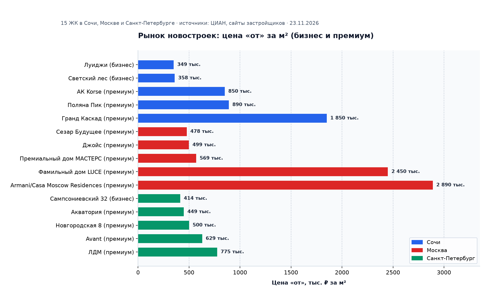

# AI-исследование рынка новостроек

Тестовое задание: анализ первичного рынка бизнес- и премиум-класса в **Сочи, Москве и Санкт-Петербурге** (15 ЖК, по 5 в каждом городе), программа-подборщик (веб + Telegram-бот), бизнес-концепция AI-инструмента и отчёт о работе с ИИ.

---

## Часть 1. Данные и аналитика

- Таблица с источниками: [`data/complexes.csv`](data/complexes.csv)
- Скрипт визуализации: [`analysis/chart.py`](analysis/chart.py)



### Ключевые показатели (цена «от», ₽/м², 23.11.2026)

| Город | Медиана | Минимум | Максимум |
|---|---:|---:|---:|
| **Сочи** | 850 000 ₽ | 349 196 ₽ | 1 850 000 ₽ |
| **Москва** | 569 340 ₽ | 477 840 ₽ | 2 890 000 ₽ |
| **Санкт-Петербург** | 500 200 ₽ | 413 822 ₽ | 775 274 ₽ |

### Выводы
1. **Дороже всего** — верхний премиум-сегмент Москвы (*Armani/Casa Moscow Residences* на Якиманке — 2,89 млн ₽/м², *LUCE* на Арбате — 2,45 млн ₽/м²) и центр Сочи (*Гранд Каскад* — 1,85 млн ₽/м²).
2. **Дешевле всего** — бизнес-класс в Сочи (*Луиджи* — 349 тыс. ₽/м², *Светский лес* — 358 тыс. ₽/м²), это самые доступные проекты во всей выборке.
3. **Неожиданный факт:** медианная цена в Сочи (850 тыс. ₽/м²) оказалась выше московской (569 тыс. ₽/м²), так как в московскую выборку вошли премиальные проекты за пределами ЦАО (*Джойс*, *Сезар Будущее* — 478–499 тыс. ₽/м²).
4. **Санкт-Петербург** — самый ровный рынок: разброс от 414 тыс. до 775 тыс. ₽/м², а самый дорогой ЖК выборки (*ЛДМ*) почти в 3,7 раза дешевле топа Москвы.
5. **Ограничения:** выборка небольшая (по 5 ЖК на город), а «цена от» отражает нижнюю границу стоимости по проекту, а не среднюю цену квартиры.

---

## Часть 2. Выполнены оба трека (бонус)

### Трек А — Программа-подборщик ЖК
Пользователь задаёт **город, бюджет и желаемую площадь** — система подбирает до 3 подходящих ЖК из таблицы и рассчитывает примерную стоимость квартиры (`цена «от» × площадь`). Если вариантов в бюджете меньше трёх, добавляются ближайшие по стоимости сверху с явной пометкой.

- **Веб-версия (основная, работает локально без сервера):** [`web/index.html`](web/index.html) (исходник [`web/template.html`](web/template.html), сборщик [`web/build.py`](web/build.py))
- **Скриншоты работы подборщика:** [`screenshots/`](screenshots/) ([Сочи](screenshots/sochi_30m_60m2.jpg), [Москва](screenshots/moscow_30m_60m2.jpg), [Санкт-Петербург](screenshots/spb_30m_60m2.jpg))
- **Консольная версия:** [`bot/cli.py`](bot/cli.py)
- **Telegram-бот:** [`bot/bot.py`](bot/bot.py) и общая логика [`bot/matcher.py`](bot/matcher.py)

### Трек Б — Бизнес и маркетинг
- Концепция AI-инструмента для агентства недвижимости (7 шагов, данные, метрики) и 3 готовых поста/сценария роликов до 60 секунд: [`TRACK_B.md`](TRACK_B.md)

---

## Часть 3. Работа с ИИ

- 5 использованных промптов, разбор реальных ошибок нейросетей (искажение цен и выдача редирект-ссылок вместо карточек ЖК) и заметки по процессу: [`PART3_AI_WORKFLOW.md`](PART3_AI_WORKFLOW.md)

---

## Структура репозитория

| Файл | Назначение |
|---|---|
| `data/complexes.csv` | База из 15 ЖК с прямыми ссылками на источники |
| `analysis/chart.py`, `analysis/price_chart.png` | Генератор графика и итоговая визуализация |
| `web/index.html` | Готовый автономный веб-подборщик |
| `screenshots/` | 3 скриншота работы веб-подборщика (Сочи, Москва, СПб) |
| `web/template.html`, `web/build.py` | Шаблон страницы и скрипт вшивания CSV |
| `bot/matcher.py`, `bot/cli.py`, `bot/bot.py` | Ядро подбора, CLI и Telegram-бот |
| `TRACK_B.md` | Бизнес-описание AI-инструмента + 3 сценария/поста |
| `PART3_AI_WORKFLOW.md` | Промпты и разбор ошибок ИИ |

## Быстрый запуск

### Вариант 1. Без установки (в браузере)
Скачайте [`web/index.html`](web/index.html) (или весь репозиторий через `Code → Download ZIP`) и **откройте `web/index.html` двойным кликом в любом браузере**. Сервер, Python и зависимости не нужны.

### Вариант 2. Через терминал (Python)
```powershell
# 1. Запустить консольный подборщик
python bot/cli.py Москва 100000000 40

# 2. Пересобрать веб-страницу после правок CSV
python web/build.py

# 3. Пересобрать график
pip install matplotlib
python analysis/chart.py

# 4. Запустить Telegram-бота (требуется доступ к api.telegram.org)
pip install python-telegram-bot
$env:BOT_TOKEN="ваш_токен"
python bot/bot.py
```

> **Примечание:** для 8 ЖК в источниках не был указан диапазон площадей — для них используется ориентировочная оценка `35–150 м²` (`area_estimated = 1`), что явно помечается в интерфейсе.
